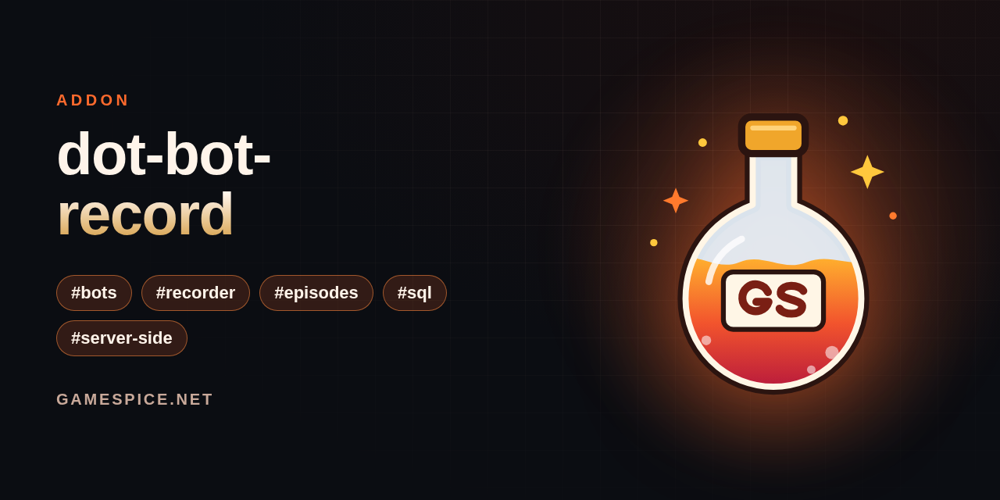

[](https://moddingcommunity.com/a/105-gs-bot-record)

A demonstration recorder for Godot 4.7+. A dedicated server records what players do, as episodes in a schema your game declares, so bots can learn from them. Part of the [GameSpice](https://github.com/gamespice-platform) family. It needs only [GameSpice Core](https://github.com/gamespice-platform/core).

This is a GameSpice addon (MIT, built with Claude Code), tested headless with `res://examples/record_selftest.tscn`. The games in [Zee's Games](https://zeesgames.com) are built on the GameSpice addons and run on live servers, so the recorder runs next to real players.

Nothing identifying is kept. Recording is on by default and is switched off with `bot_record 0`.

## Install

1. Copy `addons/gs_bot_record/` and `addons/gs_core/` into your project.
2. Enable the plugin in *Project > Project Settings > Plugins*.

## Use

Register a `GSBotDemoSchema` for each kind of episode. Then call `begin`, `sample` and `end` on a `GSBotDemoRecorder`.

The recorder samples fast while a key has few recordings and falls to a base rate once it has enough. Finished episodes are queued and written in time-budgeted batches to a store.

| Store | Use it for |
| --- | --- |
| JSON files (default) | One file per map version and kind. |
| SQL | Through [GameSpice SQL](https://github.com/gamespice-platform/sql), by duck typing. |
| Memory | Tests. |

The settings, the schema and the privacy rules are in [docs/demonstration-recorder.md](docs/demonstration-recorder.md).

## Test

```bash
godot --headless --path . --import
godot --headless --path . res://examples/record_selftest.tscn
```

## Used by

### Zee's Games

Zee's Games is a collection of games I made on GameSpice, for demonstration and for fun. They show what the platform can do, and they run on live servers you can join. Anybody can create games on GameSpice, and each addon is its own repository and can be used separately from the games and from the rest of GameSpice.

Thirteen of the fourteen games vendor it. Wipeout does not.

- [Fatal Contact](https://zeesgames.com/fatal-contact)
- [Airdrift](https://zeesgames.com/airdrift)
- [Playlot](https://zeesgames.com/playlot)
- [Hungario](https://zeesgames.com/hungario)
- [Buses From Hell](https://zeesgames.com/buses-from-hell)
- [Smash Copter](https://zeesgames.com/smash-copter)
- [Zombie Zone](https://zeesgames.com/zombie-zone)
- [Hide n Seek](https://zeesgames.com/hide-n-seek)
- [Prop Hunt](https://zeesgames.com/prop-hunt)
- [Murder Mystery](https://zeesgames.com/murder-mystery)
- [Deathrun](https://zeesgames.com/deathrun)
- [Dangerous Delivery](https://zeesgames.com/dangerous-delivery)
- [Look At Me](https://zeesgames.com/look-at-me)

The whole collection is at [zeesgames.com](https://zeesgames.com).

## Licence

MIT. See [LICENSE](LICENSE). Only the TMC back-end web infrastructure is not open source.
